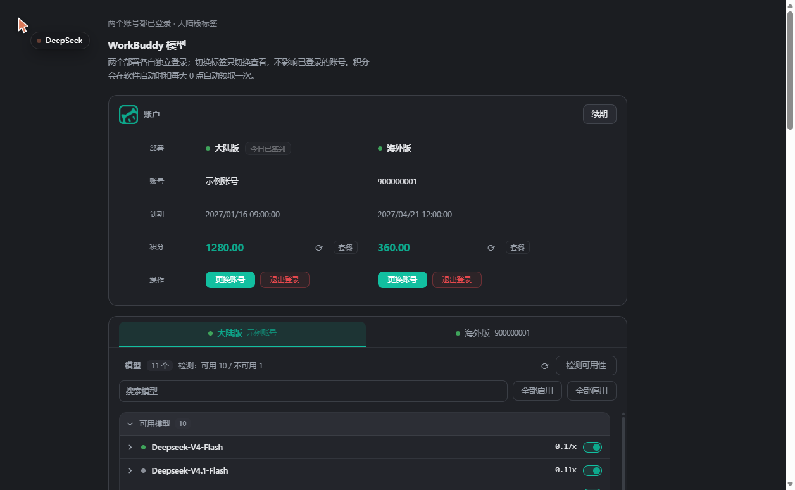

# dsh-workbuddy


在 [DeepSeek Harness](https://github.com/deepseek-ai)（DSH）里使用 **WorkBuddy** 的模型。

装好之后，WorkBuddy 的模型会直接出现在 DSH 的模型选择器里，和内置模型一样用；另有一个设置页
管理两个部署的账号（一个部署可以放多个）、查看实时倍率与繁忙程度、挑选用哪些模型。

| Provider 路由    | 部署                      |
| ---------------- | ------------------------- |
| `@huai_xin/dsh-workbuddy/cn`   | https://www.workbuddy.cn  |
| `@huai_xin/dsh-workbuddy/intl` | https://www.workbuddy.ai  |

> **非官方项目。** 与腾讯 / WorkBuddy 官方无任何关联，不使用其商标授权，也不分发其代码。
> 它只是一个第三方客户端插件，按公开可观测的接口工作。请自行确认使用方式符合你所在地区的
> 法律与 WorkBuddy 的服务条款。仓库里不含任何真实账号数据——示例与截图一律是假数据。

> **强烈建议配合 [dsh-model-picker](https://github.com/2424830124/dsh-model-picker) 一起使用。**
> 这是同一个作者的另一个插件，它读取本插件发布的客户端状态服务，在模型选择器里直接显示
> 每个部署的实时积分、模型的探测结论、繁忙状态与实时倍率——不用打开设置页就能挑模型、看状态。
> 两个插件都装上即可联动，无需任何配置。

## 安装

```sh
# 从 npm 安装到某个 profile
dsh plugin --profile <profile> add @huai_xin/dsh-workbuddy
```

也可以在 Web UI 的插件管理里安装（效果相同）。

装完**重启 DSH**，然后 `/workbuddy login cn` 或 `/workbuddy login intl` 授权。

## 用法

### 登录

```
/workbuddy login cn        # 大陆版：打开授权页，浏览器里点一下就行
/workbuddy login intl      # 海外版
/workbuddy login all       # 两个都登录
/workbuddy status          # 登录状态、模型数
/workbuddy logout cn       # 退出：删掉这个账号的凭据
/workbuddy refresh cn      # 手动续期
/workbuddy models cn       # 这个部署当前能用哪些模型
/workbuddy check cn        # 检测哪些模型真的可用（详见下文）
```

命令行只操作该部署的**第 1 个账号**；再想加账号请用设置页的「添加账号」。一个部署里还有别的
账号登录着时，退出其中一个不会把它的模型从选择器里移除。

登录完去设置页把想用的模型开关打开，它们就会出现在模型选择器里（默认全部停用）。
两个部署各自独立登录，互不影响。

**一个部署可以放多个账号**：在设置页点「添加账号」再授权一次即可，新账号排在那一栏最后。
同一个部署里的账号按显示顺序承担请求——前一个积分用尽、被限流或凭据失效时，后一个自动接手；
**大陆版的请求永远不会回退到海外版的账号**。

### 与 dsh-model-picker 联动

本插件会向客户端发布一个状态服务（`@huai_xin/dsh-workbuddy/state`），我的
[dsh-model-picker](https://github.com/2424830124/dsh-model-picker) 插件读取它，
在模型选择器里做两件事：

- **显示积分**：每个部署的实时余额直接出现在选择器里，不用打开设置页；
- **优化显示**：模型的探测结论（可用 / 限流 / 无权限…）、繁忙状态与实时倍率跟着模型一起
  展示，启用了哪些就显示哪些。

两个插件都装上即可联动，不需要任何配置。状态由本插件自动加载与刷新（每 5 分钟一次，
打开设置页的动作也会触发），选择器那边只管读。

### 设置页

设置 → WorkBuddy，两张卡片。

**账户**：一个部署一块，块里一行一个账号。

```
● 大陆版                        总积分 1234.50    [今日已签到] [套餐] [⟳]
  ● 示例账号                          1000.50    [⟳] [续期] [退出登录]
  ● 示例小号                            234.00    [⟳] [续期] [退出登录]
  [添加账号]
● 海外版                          总积分 360.00             [套餐] [⟳]
  ● 900000001                         360.00    [⟳] [续期] [退出登录]
  [添加账号]
```

- 部署名旁的圆点是登录状态（绿=已登录 / 黄=等待授权 / 红=已过期 / 灰=未登录）。
- 部署行右边的**总积分**是它下面所有账号的和；账号行右边那个数是**这个账号自己的**积分。
- **⟳** 只刷新它所在的那一行（账号行刷一个账号，部署行刷整个部署）。
- 账号行的「续期」「退出登录」都只作用于那一个账号，别的账号不受影响。
- 右上角还有一个「续期」，两个部署一起续，未登录的跳过。
- 签到按钮（只有大陆版有）在部署行上。
- 等待授权时下面会显示授权链接（重开面板也还在），不想等了就点「取消这次登录」。

**模型**：顶部标签切换查看哪个部署（只切换查看，不影响登录），标签上写着这个部署有几个账号。



- 按**能不能用**分两组：`可用模型` / `不可用模型`，后者默认折叠。
- 每行：圆点是判定颜色（绿=可用 / 黄=排队或无权限 / 红=不可用 / 灰=未检测），右侧依次是
  **可用性 · 促销 · 繁忙程度 · 实时倍率**，最后是该模型的**启停开关**。
- 被自动停用的行上还会写**已自动停用**（原因见下节）：这个开关是检测替你关的，不是你的选择。
- **模型默认全部停用**，你手动打开哪些，选择器里就有哪些；这份选择在退出登录后也保留。
- 点一行展开详情：描述、上下文、最大输出、模态、思考档位、倍率、繁忙程度、促销。
- 工具栏：搜索、「全部启用 / 全部停用」、「⟳ 刷新列表」、「检测可用性」。**全部启用**作用于
  可用分组，**全部停用**作用于两个分组。
- 开关**立即生效**，选择器马上跟着变。

### 积分与签到

- 启动约 15 秒后自动签到一次，之后每天**本地 0 点**再签到一次。
- 签到是幂等的，重启不会重复发积分。
- 部署行上的积分是它下面所有账号的和，账号行是自己那个账号的余额。
- 自动签到作用于该部署当前在用的账号。
- 海外版没有签到接口，只显示积分。

## 关于"哪些模型真的能用"

目录里列了不等于能用。这个插件会**真的发一个请求**去验证，而不是看目录字段猜。

- **大陆版**：探测不产生任何消耗，可以随便点。
- **海外版**：每个模型探测一次约 1 token，所以自动检测**每天最多一次**，「检测可用性」按钮可以手动随时点。

判定的三种结论（只有前两种会进「不可用模型」组）：

| 标签 | 含义 |
| --- | --- |
| **不可用** | 模型 id 在网关上不存在（已下架，目录里的僵尸条目） |
| **无权限** | 账号档位不够，或请求被网关拦截 |
| **未知** | 其它拿不到结论的报错（5xx、凭据问题等），悬停可看原始报文 |

没被证伪的不当成不能用，所以「未知」仍留在可用分组里。判定有效期 12 小时。

同一个部署里有多个账号时，**只要有一个账号能用，这个模型就算可用**——列表取它们的并集。

判定为不可用的模型会**自动停用**（行上写「已自动停用」）并移到「不可用模型」分组；等它恢复
可用，开关**回到你原来的状态**。你自己拨一下开关，就以你的为准——自动停用随之取消。

真实对话里如果某个模型回「不存在」或「无权限」，插件会直接记下来，不用等下次检测。

## 数据存在哪

全在 `$DSH_HOME/dsh-workbuddy/` 一个目录里，删掉它就等于把插件恢复出厂：

| 文件 | 内容 |
| --- | --- |
| `credentials.json` | 各账号的令牌（0600 权限） |
| `accounts-<部署>.json` | 这个部署的账号列表：顺序、昵称、uid |
| `catalog-<部署>.json` | 模型目录缓存 |
| `availability-<部署>.json` | 可用性判定 |
| `enabled-<部署>.json` | 你启用过哪些模型、哪些是自动停用的（退出登录不删） |
| `official-<部署>.json` | 从账号名单导入的列表 |

后加的账号，可用性判定与导入的名单各自一份文件（`availability-<部署>-<账号>.json`、
`official-<部署>-<账号>.json`）；**主账号沿用不带后缀那份**，所以升级不会丢掉已有的判定。

凭据**不**写进宿主的 `.credentials.yaml`，避免和别的插件混在一个文件里。

## 常见问题

**装完没反应 / 面板报 404？**
改了插件代码需要**重启 DSH**，重新启用插件不算。装新版本同理。

**选择器里看不到某个模型？**
它默认是停用的：去设置页把它的开关打开。如果退出过登录，模型会全部隐藏，重新登录后你
启用过的那些会原样回来。

**某个模型显示「不可用」但我想试？**
可以直接把开关打开——手动决定永远优先于检测结果。

**加了账号之后面板没变？**
授权完成后它会自己刷新。就算链接丢过（重开过面板）也不用重来：面板会把这次登录的链接显示出来，
不想等了也可以点「取消这次登录」再来一次。

**模型怎么自己关掉了？**
那是**自动停用**：检测到它当前不可用。它恢复可用之后开关会回到你原来的状态；你手动拨过开关，
就以你的为准。

**倍率显示「未知」？**
目录里没给这个模型的实时倍率。插件不会用旧值兜底、也不会猜。

**为什么没有"关闭思考"的开关？**
上游只声明了"可否关闭思考"这个字段，却从没给出能兑现它的请求参数（实测过），所以只能调**档位**。

## 许可

MIT，见 [`LICENSE`](LICENSE)。再次说明：本项目为第三方非官方插件，与腾讯 / WorkBuddy 无关联。

---

开发、排障、二次开发请看 [`AGENTS.md`](AGENTS.md)；上游接口与实测记录在
[`docs/workbuddy-protocol.md`](docs/workbuddy-protocol.md)。
